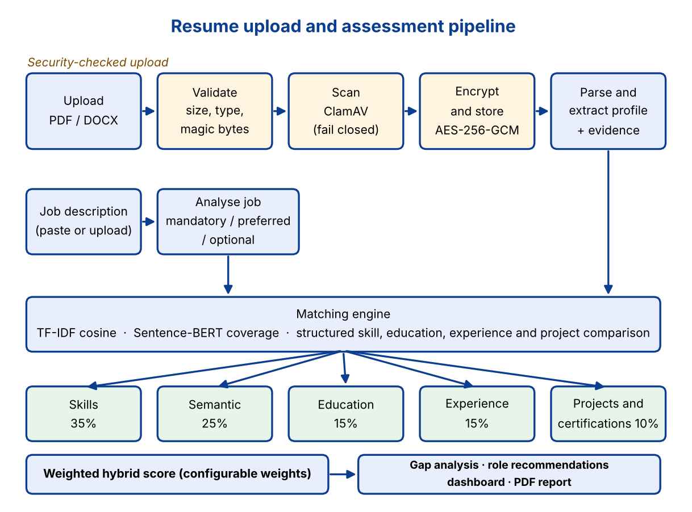
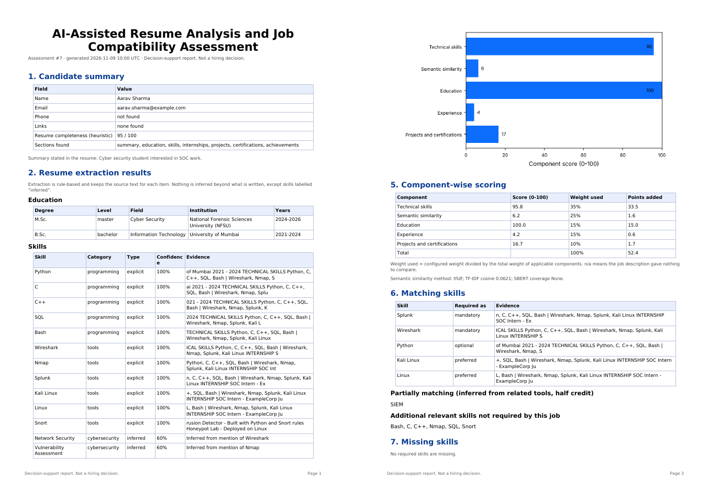
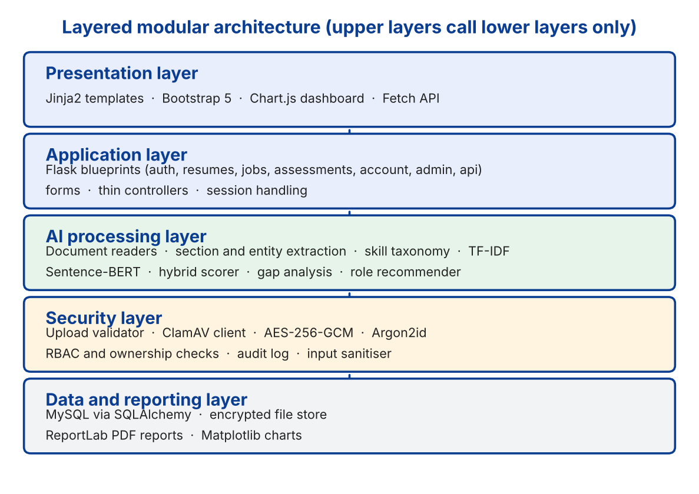
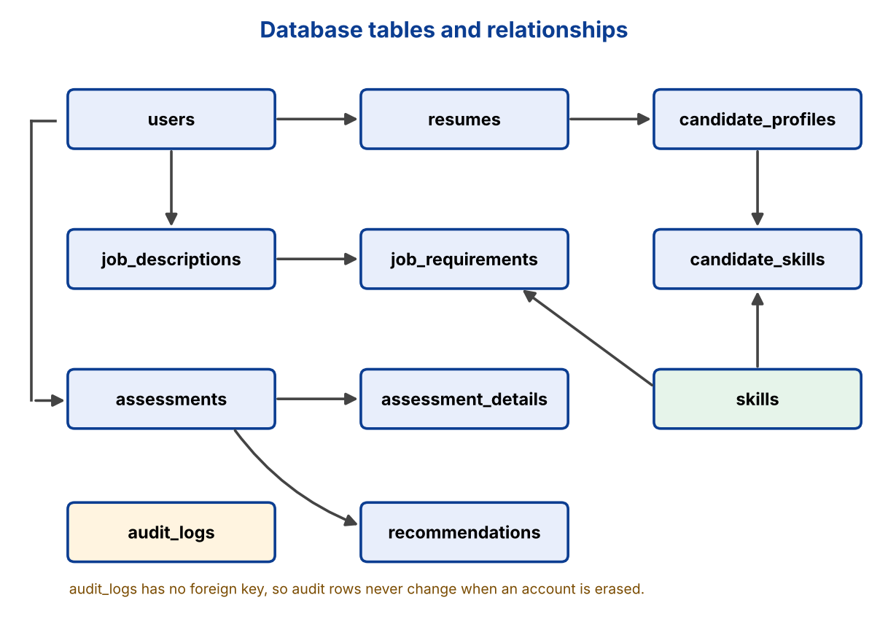

<div align="center">

# AI-Assisted Resume Analysis and Job Compatibility Assessment

**A secure, explainable decision-support platform that analyses CVs, compares them with job descriptions, and tells candidates how well they match and whether they are likely to be eligible.**


*M.Sc. Cyber Security final-year project · National Forensic Sciences University (NFSU), Gandhinagar, Gujarat, India*

</div>

---

## Overview

Keyword-based CV filters are shallow, give scores nobody can explain, and handle sensitive documents carelessly. This project tackles all three problems together:

- **Meaning, not keywords.** A hybrid engine combines TF-IDF, Sentence-BERT embeddings and structured skill, education, experience and project matching.
- **Explainable.** Every percentage is broken down by component, with the evidence taken from the CV.
- **Secure by design.** Uploads are validated and virus-scanned, stored encrypted, and protected by strict access control. Text hidden inside a document can never change a score.
- **Decision support, not decision making.** The system informs a person; it never makes a hiring decision.

## Features

| Area | What you get |
|---|---|
| **Job board** | Administrators post jobs; candidates browse them, upload a CV and instantly see a **match percentage**, an **eligibility verdict** (*Likely eligible*, *Partially eligible*, *Not eligible yet*) and the reasons |
| **Secure CV upload** | PDF and DOCX only; extension, magic-byte and structure checks (macros, embedded objects, remote templates, zip bombs, path traversal); ClamAV scan that fails closed; AES-256-GCM encryption at rest |
| **Evidence-based extraction** | Name, contacts, education, skills, certifications, internships, experience, projects and achievements, each with its source text. Missing information is never invented |
| **Skill taxonomy** | Cyber security, programming and tool skills with aliases; explicit versus inferred skills; extensible by administrators |
| **Job analysis** | Requirements marked mandatory, preferred or optional only when the job text says so; administrators can correct them |
| **Hybrid score** | Skills, semantic similarity (Sentence-BERT `all-MiniLM-L6-v2`), education, experience, projects and certifications, with configurable weights |
| **Skill-gap analysis** | Matched, partial, missing and additional skills, with a points estimate for each gap |
| **Career roles** | Ten cyber security roles recommended from evidence in the CV, with certifications and learning roadmaps |
| **Dashboard and reports** | Charts (Chart.js), assessment history and a twelve-section downloadable PDF report |
| **Privacy tools** | Candidates can export or permanently erase all their data; administrators see totals only, never CVs |

## How it works

<p align="center"></p>

**Eligibility rules.** The percentage is the hybrid compatibility score. A candidate is *likely eligible* when it reaches the job's threshold and every mandatory requirement is evidenced in the CV. They are *partially eligible* when within 15 points of the threshold with at most one mandatory requirement unmet (or a mandatory skill only implied by related tools). Otherwise the result is *not eligible yet*. The percentage shows how well the CV text matches the job; it is **not** a probability of being hired.

**Score.** Final = Σ (weight × component score) ÷ Σ (weights of the applicable components). The initial weights are experimental hypotheses: skills 35, semantic 25, education 15, experience 15, projects and certifications 10. They are configurable and are meant to be validated with the experiments in this repository.

<p align="center"><br><em>Pages of a generated PDF report (sample data)</em></p>

## Architecture

<p align="center"></p>

A modular monolith with five layers and one-way dependencies. The AI layer is made of pure functions with no database or network access, so the experiments reuse exactly the same code as the web application.

## Security highlights

| Control | Implementation |
|---|---|
| Passwords | Argon2id, 12-character policy, lockout after repeated failures, one-time expiring reset tokens |
| Sessions | HttpOnly and SameSite cookies, sliding and absolute lifetimes, binding to the browser identity |
| Access control | Server-side role checks on every route, ownership checks that return 404, administrators cannot read CVs |
| Uploads | Layered validation, ClamAV scanning (fail closed), random server-side names |
| Data at rest | AES-256-GCM with a key per file wrapped by a master key kept outside the database |
| Web defences | CSRF tokens, output escaping, strict Content-Security-Policy without inline scripts, rate limiting, security headers |
| AI security | Deterministic scoring, instruction-like text flagged and excluded, hidden text removed, keyword stuffing flagged, no external AI services |
| Audit | Hash-chained audit log with an integrity check; personal data never written to logs |

## Technology

Python · Flask · SQLAlchemy · MySQL/MariaDB · scikit-learn · sentence-transformers · PyMuPDF · python-docx · ReportLab · Matplotlib · Chart.js · Bootstrap 5 · Argon2 · cryptography · ClamAV · pytest · Bandit · pip-audit.

Extraction is rule-based (headings, regular expressions and the skill taxonomy). spaCy and NLTK are part of the planned stack and installed, but are not used by the current extraction code; a trained entity model is future work.

## Quick start (Kali Linux / Ubuntu)

**Prerequisites:** Python 3.10+, MariaDB or MySQL 8, the ClamAV daemon and `libmagic`.

```bash
sudo apt install -y python3-venv python3-dev build-essential libmagic1 mariadb-server clamav clamav-daemon
sudo freshclam && sudo systemctl enable --now clamav-daemon mariadb

git clone https://github.com/africanethicalhacker/AI-assisted-resume-analysis-and-job-compatibility-assessment.git
cd AI-assisted-resume-analysis-and-job-compatibility-assessment

python3 -m venv .venv && source .venv/bin/activate
pip install torch --index-url https://download.pytorch.org/whl/cpu
pip install -r requirements.txt
python -m spacy download en_core_web_sm
```

Create the database and user, then configure the environment:

```sql
CREATE DATABASE resume_ai CHARACTER SET utf8mb4;
CREATE USER 'resume_app'@'localhost' IDENTIFIED BY 'choose-a-strong-password';
GRANT SELECT, INSERT, UPDATE, DELETE, CREATE, ALTER, INDEX, DROP, REFERENCES ON resume_ai.* TO 'resume_app'@'localhost';
```

```bash
cp .env.example .env             # then fill in SECRET_KEY, MASTER_KEY and DATABASE_URL
python scripts/generate_keys.py  # prints fresh keys to paste into .env
flask --app run db init && flask --app run db migrate -m "initial" && flask --app run db upgrade
python scripts/seed_taxonomy.py
python scripts/create_admin.py
python scripts/vendor_assets.py  # optional: serve Bootstrap and Chart.js locally
python run.py                    # http://127.0.0.1:5000
```

> **Back up `MASTER_KEY`.** Without it, stored CVs cannot be decrypted. Never commit `.env`.

Full details: [`docs/installation_manual.md`](docs/installation_manual.md).

## Using the platform

**Administrator**
1. Log in and open **Jobs**, then post a job by pasting the description or uploading a file.
2. Set the match percentage needed to be eligible and review the detected requirements; correct any classified wrongly.
3. Watch totals for each job, manage the skill taxonomy and scoring weights, and review the audit log.

**Candidate**
1. Register and log in, then open **Job board** and choose a job.
2. Upload your CV and read your match percentage, verdict, reasons and what would improve your result.
3. Download the PDF report, see career suggestions, or export and erase your data from **Account**.

See [`docs/user_manual.md`](docs/user_manual.md).

## Testing and verification

```bash
python -m pytest -v                       # unit, integration and security tests
python -m experiments.run_security_suite  # security cases with expected vs actual results
bandit -r app                             # static analysis
pip-audit                                 # dependency vulnerabilities
```

In the author's evaluation run on Kali Linux, the test suite passed, the security suite passed all of its 42 cases (including live ClamAV detection of the EICAR test string), Bandit reported no high or medium findings, and pip-audit reported no known vulnerabilities after one dependency upgrade.

## Evaluation experiments

Six reproducible experiments are provided in [`experiments/`](experiments/README.md): TF-IDF versus Sentence-BERT, skill matching versus the hybrid model (with ablations and held-out weight tuning), extraction accuracy, performance, security testing, and a bias and fairness screening. They report Precision@K, Recall@K, nDCG, MRR, F1, time and memory with bootstrap confidence intervals.

No accuracy claim is made until measured on a properly labelled dataset. Use consented, anonymised or licensed data only, and never commit real CVs (the `.gitignore` excludes `experiments/data/`).

## Repository layout

```text
app/            Flask application (models, routes, services, ai, security, reporting, templates)
experiments/    Reproducible evaluation scripts and metrics
tests/          Unit, integration and security tests
scripts/        Setup, maintenance and self-test scripts
docs/           Requirements, manuals, schema, diagrams and report chapters
```

| Document | Purpose |
|---|---|
| [`docs/SRS.md`](docs/SRS.md) | Requirements with traceability to code and tests |
| [`docs/installation_manual.md`](docs/installation_manual.md) | Step-by-step installation |
| [`docs/user_manual.md`](docs/user_manual.md) | Candidate and administrator guide |
| [`docs/schema.sql`](docs/schema.sql) | MySQL reference schema |
| [`docs/test_cases.md`](docs/test_cases.md) | Catalogue of automated tests |

<p align="center"></p>

## Limitations and responsible use

- Extraction is rule-based and can misread complex layouts; scanned documents need OCR, which is not implemented.
- The skill taxonomy is finite and focused on cyber security.
- Scoring weights and eligibility rules are explainable but experimental until validated on real labelled data.
- Pattern-based injection detection is not exhaustive; malware scanning is signature-based.
- Semantic models can carry bias. Use the results as one input to a human decision, never as the sole basis for rejecting or selecting anyone.

## Project team and credits

**Project supervisor:** Dr. Naha Gaulam

**Team:** YOUR TEAM NAME

| Member | Role |
|---|---|
| Adoum Youssouf Hassane | Project author and lead developer |
| [Team member name] | [Role] |
| [Team member name] | [Role] |

Developed at the **National Forensic Sciences University (NFSU), Gandhinagar**, as part of the M.Sc. Cyber Security programme.

## License

Released under the [MIT License](LICENSE).

---

<div align="center"><sub>Decision-support tool. Scores are not hiring decisions.</sub></div>
