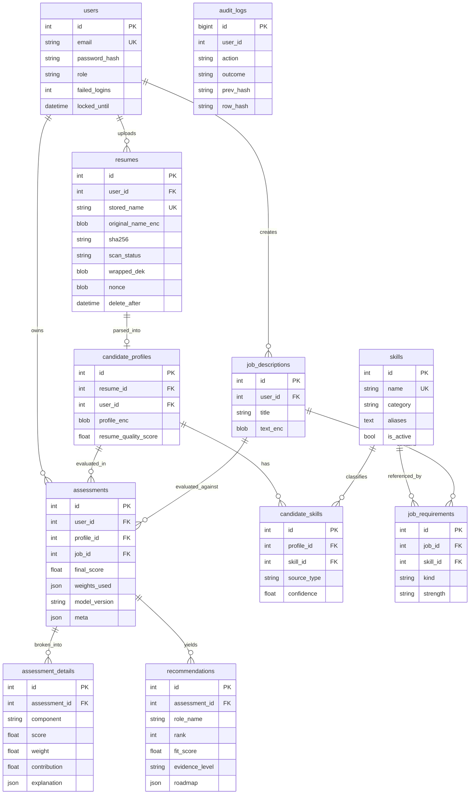

# Diagrams (updated for the final design)
The architecture, DFD, use-case, class, sequence, activity and deployment diagrams from Phase 2 remain valid. This file adds the final ER diagram.
Render the Mermaid blocks at mermaid.live, or in VS Code with a Mermaid extension, and export PNG or SVG for the thesis.

Note: `audit_logs.user_id` is intentionally not a foreign key, so audit rows are unchanged when an account is erased.
